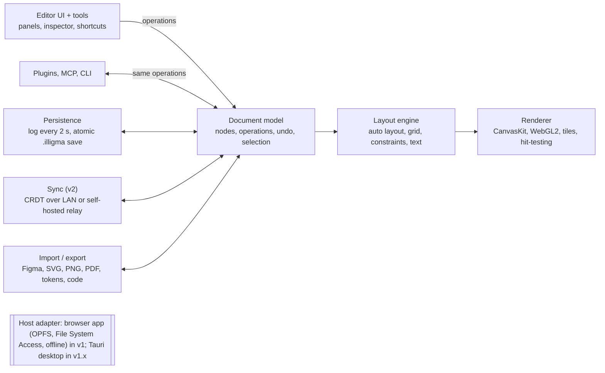
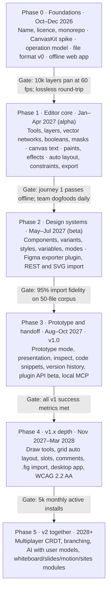

# Illigma — PRD: Local, Open-Source Figma

Oct 12, 2026 · rahulornob

## 1. Summary

Illigma will be an open-source, local-first interface design tool that matches Figma Design's core editing model and keeps every file on the user's own disk. It runs in the browser first, as an installable app that works fully offline; a desktop app follows, and optional peer or self-hosted collaboration comes in v2. No account, no cloud, no seat licence.

**Problem.** Figma is the default tool for UI design, but it is cloud-only, closed, and priced per seat. Files live on Figma's servers in a proprietary format. Offline use is limited. Teams cannot audit, self-host, extend the core, or guarantee long-term access to their own work.

**Vision.** "Figma's editing model, your files, your machine." A designer who knows Figma should be productive in Illigma within an hour: same concepts (frames, auto layout, components, variables, prototypes), same shortcuts where trademark-safe, and a familiar three-panel layout with Illigma's own visual identity.

**Why local and open source.**

- **Ownership:** files are plain, documented, versionable artifacts (works with Git, Dropbox, a USB stick).
- **Privacy:** nothing leaves the machine unless the user turns on sync. Suitable for regulated or air-gapped teams.
- **Cost:** free for individuals and teams; no per-editor billing.
- **Speed:** no network round-trips; files open from disk.
- **Extensibility:** plugins and the core itself are modifiable; AI agents can read and write the file format directly.

**Starting point.** Illigma already exists as a browser vector editor (Vite, vanilla JavaScript, SVG workspace, Paper.js booleans) with pages, nested frames, pen and shape tools, Pathfinder, text with local and Google fonts, effects, auto layout (stack, wrap, grid), constraints, and `.illigma` JSON save. This PRD defines the path from that prototype to a full local-first Figma alternative.

## 2. Goals, non-goals, success metrics

v1 succeeds when a working product designer can build and hand off a multi-screen app design with a component library, entirely offline, without opening Figma.

**Goals**

1. **Core Figma Design parity** for the daily-use 80%: frames, auto layout, constraints, components and variants, variables and modes, styles, text, vector editing, prototyping, export.
2. **Local-first files:** an open, documented file format on disk; autosave; crash-safe; full history.
3. **Performance at real scale:** files with 10k+ layers and dozens of pages stay smooth.
4. **Migration path in:** import from Figma (REST API and best-effort `.fig`), SVG, and Penpot.
5. **Developer handoff:** inspect mode with CSS, Tailwind, SwiftUI and Compose snippets, token export, and a local MCP server for AI agents.
6. **Open ecosystem:** a plugin API close enough to Figma's that common plugins port with small changes.
7. **Optional collaboration (v2):** real-time multiplayer over a CRDT, peer-to-peer on a LAN or via a self-hosted relay. Never required.

**Non-goals (v1)**

- Hosted cloud service, accounts, billing, or org admin.
- FigJam, Slides, Sites, Buzz, and Make equivalents (candidates for later modules).
- Byte-level compatibility with Figma's private `.fig` format or Figma's servers.
- Running Figma's own plugins unmodified.
- Pixel-identical rendering to Figma; visual fidelity within tolerance is the bar.
- Copying Figma's or Framer's brand, logos, icons, or trade dress. No paid plans or commercial edition: Illigma is a pure community project.

**Success metrics**

| Metric | v1 target |
| --- | --- |
| Cold start to editable canvas (installed web app) | under 1.5 s |
| Open a 10k-layer file | under 2 s |
| Pan and zoom frame rate on a 10k-layer page | 60 fps on a 2021 laptop |
| Input latency (drag, type) | under 16 ms per frame |
| Figma import fidelity on a 50-file test corpus | 95% of layers within 1 px and correct properties |
| Data loss incidents (crash, power cut) | zero; last 2 s of edits recoverable |
| Figma users completing a 10-task usability script unaided | 80% |
| Community: GitHub stars / monthly active installs 12 months after v1 | 10k / 5k |
| Plugins ported or written for Illigma at v1 + 6 months | 25 |

## 3. Users and jobs-to-be-done

The primary user is a product designer who already knows Figma; every design decision is tested against "would a Figma user find this where they expect it?"

| Persona | Context | Top jobs | What makes them switch |
| --- | --- | --- | --- |
| Product designer (primary) | Freelancer or small team, designs app and web UI daily | Lay out screens with auto layout; build and reuse components; theme with variables; prototype flows | No seat cost, offline work, owns files |
| Design-system maintainer | Owns a component library for several products | Publish components and tokens; version them; push updates to consumer files | Libraries as files in Git; token export to code |
| Front-end developer | Implements designs | Inspect spacing, colours, typography; copy code; export assets; read tokens | Free inspect mode; MCP server for AI coding tools |
| Privacy-bound team | Government, health, finance, defence, air-gapped | Design without data leaving the network; audit the tool | Self-hosted, auditable source, no telemetry by default |
| Student and educator | Learning UI design, often on low-cost hardware | Follow Figma tutorials with a free tool | Free forever, runs offline, Figma-like concepts |
| Open-source contributor | Builds plugins or the core | Extend tools, fix bugs, add exporters | Clean architecture, documented format, plugin API |
| AI agent (non-human user) | Coding or design agents acting for a user | Read and write documents, generate screens, extract tokens | Open file format, local MCP and CLI |

**Core user journeys (v1 acceptance scenarios)**

1. Open Illigma in the browser, install it as an app, create a file, design a 5-screen mobile flow with auto layout, and save to a folder of the user's choice, all with networking disabled.
2. Import an existing Figma file through the REST API importer and keep editing with components and variables intact.
3. Build a button component with 3 variant properties and 2 modes (light, dark), then use it across screens.
4. Wire a clickable prototype with Smart Animate and present it full screen.
5. Hand off: a developer opens the same file in inspect mode, copies CSS, exports SVG and PNG at 1x/2x/3x, and exports tokens as JSON.
6. Save the file to a synced folder (iCloud Drive, Dropbox, a USB stick), reopen it on another machine, reload when it changed on disk, and restore an earlier version from version history. Teams can also keep files in Git, because a file is a normal file on disk, but this is optional and outside the app.

## 4. Figma product surface audit

Figma is now 15+ products and AI services on one canvas; Illigma v1 targets Figma Design plus Dev Mode inspect, and plans every other product as a later module. Every Figma feature is listed, 5,356 rows from all 896 Help Center articles plus the Plugin API, REST API, and shortcuts, in the **Feature inventory** tabs.

| Figma product | What it does | Status at Oct 2026 | Illigma scope |
| --- | --- | --- | --- |
| Figma Design | Vector and UI design editor; UI3 redesign in 2024 | GA since 2016 | v1 core |
| Figma Draw | Illustration tools inside Design: lasso, brushes, variable-width strokes, text on path, repeaters, pattern fills, noise, texture, progressive blur | Shipped May 7, 2025 | v1.x |
| Dev Mode | Inspect, code snippets, annotations, ready-for-dev status, compare changes, Code Connect | Paid Dev seat since 2024 | Inspect in v1; rest v1.x |
| MCP server | Remote and desktop MCP: read design context, variables, screenshots; write to canvas | GA (Schema 2025) | Local MCP in v1.x |
| FigJam | Whiteboard: stickies, connectors, sections, tables, stamps, widgets | Launched April 2021 | Module (v2+) |
| Figma Slides | Slide decks on the canvas with live embeds | GA March 19, 2025 | Module (v2+) |
| Figma Sites | Responsive site builder and publishing; CMS announced | Open beta | Module; static HTML export first |
| Figma Make | Prompt-to-React app builder with npm packages and Make kits | GA, consumes AI credits | Module via bring-your-own model |
| Figma Buzz | On-brand marketing assets from locked templates, bulk from data | Open beta | Module |
| Figma Motion | Timeline and keyframe animation; exports CSS, React, Lottie, MP4, GIF | Open beta from June 24, 2026 | Module |
| Shaders | AI-generated WebGPU shader fills and effects | Open beta (Config 2026) | v2+ |
| Figma agent and AI tools | In-editor agent, rename layers, generate and edit images, translate text, visual search | Agent GA Oct 6, 2026 | v2+, user-supplied model |
| Weave | Node-based AI image and video generation (Weavy acquisition) | Standalone; Design tools GA Oct 6, 2026 | Out of scope |
| Code Layers | React code components as canvas layers | Closed beta | v2+ research |
| 3D transforms | 3D depth on layers and images | Waitlist | v2+ research |
| Community | Publish and remix files, plugins, widgets | GA | Plugin and template registry (Git-based) |
| Administration | Teams, orgs, seats, SSO, SCIM, workspaces, analytics | GA | Mostly not applicable; local equivalents noted in inventory |

**Where Figma is weakest, and Illigma's opening**

- **No real offline mode.** Figma states it has no plans for one; only already-loaded pages can be edited offline, and changes are kept 30 days (7 in Safari).
- **2 GB memory cap per tab**, including desktop; large files lock into recovery mode.
- **No Linux desktop app.** The desktop app is Electron on macOS and Windows only.
- **Closed format.** `.fig` is an undocumented Kiwi binary; there is no export to open formats.
- **Cost and pricing churn.** Full seats cost $16–$90 per month; AI credits began metering in 2026 and drew heavy complaints.
- **Trust.** A 2025 class action (Khan v. Figma) alleges default opt-in to AI training; Figma denies it.

## 5. Functional requirements

P0 ships in v1.0 (MVP), P1 in v1.x, P2 in v2+. "Today" records what the current Illigma prototype already does, based on its README and code at commit 8e3bd2f.

### 5.1 Files, pages, canvas

| Requirement | Priority | Today |
| --- | --- | --- |
| Home screen: recent files, folders, templates; open any file from disk; drag-and-drop to open | P0 | No (single document in browser storage) |
| Multiple pages per file; add, rename, reorder, duplicate, delete | P0 | Yes (up to 100 pages) |
| Infinite canvas, zoom 1%–25,600%, zoom to fit/selection, minimap | P0 | Yes (2%–25,600%), no minimap |
| Sections: named canvas regions that group frames, with "ready for dev" status | P1 | No |
| Rulers, ruler guides, layout guides (columns, rows, grid) on frames | P0 | Partial |
| Smart guides, snapping to objects, pixel grid, snap to pixel, Alt-measure distances | P0 | Partial |
| Pixel preview and outline mode | P1 | No |
| Per-page canvas background | P0 | Yes |

### 5.2 Layers, selection, transform

| Requirement | Priority | Today |
| --- | --- | --- |
| Layer tree: frames, groups, sections, components, instances, booleans, text, vectors, images | P0 | Partial (no nested groups) |
| Rename, hide, lock, reorder by drag, collapse, search and filter layers | P0 | Mostly |
| Click, shift-click, marquee, deep select (Cmd-click), Enter / Shift+Enter to traverse, select-under-pointer menu | P0 | Partial |
| Move, resize, rotate on canvas with handles; aspect lock; resize from centre (Alt) | P0 | Yes |
| Align, distribute, tidy up; smart selection spacing handles | P0 | Align yes; smart selection no |
| Scale tool (K) scaling strokes, text and effects proportionally | P1 | No |
| Copy/paste between files and as SVG/PNG; paste properties | P0 | Partial |
| Multi-edit: mixed values shown in the inspector across a selection | P0 | Partial |

### 5.3 Drawing and vector

| Requirement | Priority | Today |
| --- | --- | --- |
| Frame, rectangle, ellipse (with arc), line, arrow, polygon, star tools | P0 | Frame, rect, ellipse |
| Pen tool with vector networks (points with more than two connections) | P0 | Single-contour paths |
| Vector edit mode: bend, add/remove points, mirror handles, corner radius per point | P0 | Partial |
| Pencil (freehand) tool | P1 | No |
| Non-destructive boolean groups (union, subtract, intersect, exclude) | P0 | Destructive Pathfinder only |
| Shape builder | P1 | Yes |
| Flatten, outline stroke, offset path, simplify, text to outlines | P1 | Partial |
| Masks: alpha, vector, luminance | P0 | No (frame clip only) |
| Images: place, fill modes (fill, fit, crop, tile), crop, basic adjustments | P0 | Unclear |
| Slices and export regions | P1 | No |

### 5.4 Paint, stroke, effects

| Requirement | Priority | Today |
| --- | --- | --- |
| Multiple fills per layer: solid, linear/radial/angular/diamond gradient, image, video (P2) | P0 | Single solid fill |
| Colour picker: HSB, RGB, HSL, hex, alpha, eyedropper, document colours, OKLCH (P1) | P0 | Yes, no alpha model |
| Strokes: inside/centre/outside, per-side widths, dash, caps, joins, arrowheads, variable width (P2) | P0 | Basic |
| Corner radius per corner and corner smoothing (squircle) | P0 | Partial |
| Blend modes per layer and per paint; layer opacity | P0 | Opacity only |
| Effects stack: drop shadow, inner shadow, layer blur, background blur, noise and texture (P1), progressive blur (P1), glass (P2) | P0 | First four yes |

### 5.5 Layout

| Requirement | Priority | Today |
| --- | --- | --- |
| Auto layout stack: direction, gap (fixed/auto), independent padding, alignment, wrap, baseline, reverse z-order | P0 | Yes (most) |
| Sizing: fixed, hug, fill; min/max width and height | P0 | Yes |
| Absolute-positioned children inside auto layout | P0 | Yes (ignore auto layout) |
| Grid auto layout: tracks (fixed, fr, auto), spans, auto placement | P1 | Partial |
| Constraints: left, right, left-and-right, centre, scale per axis; resize with constraints ignored | P0 | Yes |
| Layout output matches CSS flexbox and grid semantics (enables faithful code export) | P0 | Partial |

### 5.6 Text

| Requirement | Priority | Today |
| --- | --- | --- |
| Text boxes: auto width, auto height, fixed; truncation with ellipsis and max lines | P0 | Partial |
| Rich text: mixed font, size, weight, colour, link per character range | P0 | No |
| Paragraph: line height, letter spacing, paragraph spacing, alignment, vertical trim, lists | P0 | Partial |
| Fonts: system fonts enumerated, local file import, Google Fonts download and cache, missing-font replacement dialog | P0 | Import and Google Fonts yes; system enumeration no |
| Variable fonts (axes) and OpenType features | P1 | Weight axis only |
| Shaping for RTL and complex scripts; IME input | P0 | Browser-dependent |
| Text on path | P2 | No |

### 5.7 Components and design systems

| Requirement | Priority | Today |
| --- | --- | --- |
| Create component; instances stay linked; overrides preserved on update; reset and detach | P0 | No |
| Variants and component sets with named properties | P0 | No |
| Component properties: boolean, text, instance swap, variant; preferred values | P0 | No |
| Slots (designated content areas in an instance) | P1 | No |
| Nested instances with exposed properties | P1 | No |
| Styles: colour, text, effect, layout grid | P0 | Swatches only |
| Variables: colour, number, string, boolean; collections; modes; aliases; scoping; code syntax | P0 | No |
| Expressions on variables (math, conditionals) | P2 | No |
| Libraries: any file can be a library; link libraries from local folders or Git repos; update notifications with diff and accept/reject | P1 | No |
| Token import/export: W3C Design Tokens (DTCG) JSON, CSS variables, Tailwind config | P1 | No |

### 5.8 Prototyping and presentation

| Requirement | Priority | Today |
| --- | --- | --- |
| Prototype tab: connections between frames, flows with starting points | P0 | No |
| Triggers: click, hover, press, drag, key, after delay, mouse enter/leave | P0 | No |
| Actions: navigate, back, overlay (open/swap/close), scroll to, open link, set variable, conditional | P0 (conditionals P1) | No |
| Transitions: instant, dissolve, move, push, slide, Smart Animate; easing and spring curves | P0 | No |
| Scroll behaviour: overflow scroll, fixed and sticky layers | P0 | No |
| Interactive components (variant changes on interaction) | P1 | No |
| Presentation player in a window or full screen, device frames, share as a static HTML bundle | P0 | No |

### 5.9 Inspect, export, and handoff

| Requirement | Priority | Today |
| --- | --- | --- |
| Export PNG, JPG, WebP, SVG, PDF at custom scales and suffixes; batch export | P0 | SVG only |
| Inspect mode: redlines, spacing measurements, properties panel read-only | P0 | No |
| Code snippets: CSS, Tailwind, React (JSX), SwiftUI, Jetpack Compose; pluggable generators | P1 | No |
| Variables and styles shown with token names in snippets | P1 | No |
| Local MCP server and CLI exposing read/write of documents, selection, screenshots, tokens | P1 | No |
| Annotations and dev status on sections and frames | P1 | No |

### 5.10 History, review, collaboration

| Requirement | Priority | Today |
| --- | --- | --- |
| Undo/redo per document (100+ steps), surviving page switches | P0 | Yes (session only) |
| Version history: autosaved snapshots plus named versions; restore, duplicate from version | P0 | No |
| Visual diff between versions | P1 | No |
| Comments pinned to canvas points, threads, resolve; stored in the file | P1 | No |
| Branching and merging of a file | P2 | No |
| Real-time multiplayer: cursors, selections, follow mode, presence; LAN peer-to-peer or self-hosted relay | P2 | No |

### 5.11 Import and interoperability

| Requirement | Priority | Today |
| --- | --- | --- |
| Illigma exporter plugin that runs inside Figma and saves the current file as .illigma (components, variables, styles, prototypes); main migration path because REST limits can be as low as 6 file reads a month | P0 | No |
| Import from Figma via the REST API with a user's personal access token | P0 | No |
| Import `.fig` files directly (best effort) | P1 | No |
| Import and export SVG with editable paths and text | P0 | Export only |
| Import Penpot files; import Sketch files | P2 | No |
| Export to HTML/CSS for static pages | P2 | No |

### 5.12 Plugins and AI

| Requirement | Priority | Today |
| --- | --- | --- |
| Plugin API modelled on Figma's node API (`illigma.*` mirroring `figma.*` where sensible); sandboxed UI iframe | P1 | No |
| Plugin install from a local folder, a Git URL, or a community registry | P1 | No |
| Widgets (interactive canvas objects) | P2 | No |
| AI features via a user-configured provider (local model or API key): rename layers, generate screen from prompt, fill with realistic content, lint against design system | P2 | No |

### 5.13 Shell and preferences

| Requirement | Priority | Today |
| --- | --- | --- |
| Three-panel shell: layers/pages left, properties right, toolbar; collapsible UI (Shift+\\) | P0 | Yes (bottom toolbar) |
| Light and dark themes | P0 | Dark only |
| Command palette / quick actions (Cmd+/) | P0 | No |
| Keyboard shortcuts close to Figma's, fully remappable | P0 | Partial |
| Nudge amounts, units, snapping, and other preferences | P0 | Partial |

### 5.14 Current Illigma designs (Figma file "Illigma", checked Oct 12, 2026)

The existing mockups cover onboarding, the file home screen, and the editor's left sidebar, in a dark style captured from Framer's dashboard; three things must change before they become the v1 UI.

| What exists | Finding | Requirement |
| --- | --- | --- |
| Onboarding: "Welcome to illigma · Your Free Design Partner", name field, Continue | Logo vector is Framer's "F" mark | Replace with an original Illigma logo before any public build (P0) |
| Home screen: workspace switcher, search, All / Archive / New folder, file cards, "New project", "Invite your team", "Copy link", "Free" badge | Copied from Framer's cloud dashboard; team invite, share links, and plan badges assume accounts | Local-first home: recent files, folders on disk, Open file, New file, templates, Reveal in Finder, Archive as a local folder; no invite or plan badge (P0) |
| File menu: Open in new tab, Copy link, Copy remix link, Pin, Duplicate, Move, Rename, Archive | Copy link and remix link need a server | Keep Pin, Duplicate, Move, Rename, Archive; replace links with Show in folder and Export (P0) |
| Toast: "Archived Beige Beginning." with Dismiss | Good pattern | Add Undo to every destructive toast (P0) |
| Editor sidebar: workspace, project switcher ("Figma basics"), search, Pages list, Layer list | Matches section 5.1 and 5.2; placeholder text uses Figma's name | Remove Figma's name from UI copy (P0) |
| Components: Button, Input Field (filled, placeholder), 7 icons (search, sidebar, 4 arrows, frame), page row (default, active, divider) | Small start; no variables, no colour styles, 2 text styles | Build the Illigma UI kit with variables (light and dark modes) and styles before Phase 1 UI work (P0) |

**Design tokens in use:** Inter and Inter Variable UI at 10, 12, 13 and 20 px; background #111111, surfaces #1F1F1F and #181818, text #FFFFFF and #999999, borders white at 5% to 20% opacity, accent #0099FF (Framer's blue, which should also be replaced with an Illigma accent).

### 5.15 Visual direction (decided Oct 12, 2026)

Illigma should feel instantly familiar to Figma and Framer users while looking like its own product.

| Borrow | From | Make it Illigma's own |
| --- | --- | --- |
| Panel layout: layers and pages left, properties right, toolbar, canvas centre | Figma | Own toolbar placement and grouping; Illigma names for panels |
| Calm, dense dark UI with soft surfaces and quiet borders | Framer | Original colour palette and accent (not #0099FF); light theme of equal quality |
| Keyboard shortcuts and interaction patterns | Figma | Remappable; documented in an Illigma shortcut sheet |
| Typography: Inter-style UI type at 11–13 px | Both | Choose an open-licence UI typeface and type scale as tokens |
| Logo, icons, illustrations | Neither | Original logo, icon set, and empty-state art; no Figma or Framer marks |

Deliverable before Phase 1 UI work: an Illigma UI kit in Figma with variables for light and dark modes, built on the tokens in 5.14.

## 6. Local-first architecture

Decision (Oct 12, 2026): rebuild the core as a TypeScript monorepo with a GPU canvas renderer, an operation-based document model, and a web-first shell (installable offline web app now, Tauri desktop app later), in a new codebase built from scratch. The prototype's layout and geometry logic is a tested reference, not code to keep.

The UI, plugins, MCP, sync, and importers all change the file by sending the same operations to the document model; layout and rendering only read from it, so undo, saving, and collaboration work the same for every source of change.

**Why not evolve the current SVG workspace.** One DOM node per layer stops scaling at a few thousand layers, text measurement depends on the browser, and export fidelity drifts from what the canvas shows. Figma itself draws everything on a GPU canvas with its own text and layout engines. The auto layout, constraints, and Pathfinder logic in `src/autolayout.js`, `src/constraints.js`, and `src/geometry.js` is a tested reference for the new engine.

### 6.1 Building blocks

| Layer | Choice (v1) | Alternatives considered | Reason |
| --- | --- | --- | --- |
| Language | TypeScript, strict; Rust for hot paths later | Rust-first (WASM) | Largest contributor pool; port existing JS |
| Document model | Flat map of nodes keyed by stable IDs; parent ID + fractional index for order; every change is a property-level operation | Nested JSON tree | Cheap undo, diffs, and CRDT merge; mirrors how Figma's multiplayer model works |
| Renderer | CanvasKit (Skia compiled to WASM) on WebGL2, WebGPU when stable; tile cache and level-of-detail | Canvas2D, raw WebGL, Vello | Production-grade paths, gradients, blurs, blend modes, and image filters out of the box; same output in desktop and web |
| Text | CanvasKit Paragraph API (HarfBuzz shaping, ICU line breaking) with our own text-box model | Browser DOM measurement | Deterministic layout across platforms; RTL and complex scripts |
| Layout | Own engine for auto layout and constraints (ported), validated against CSS flexbox/grid; Taffy as reference | Yoga, Taffy only | Figma semantics (hug, fill, auto gap, ignore layout) differ from CSS in edge cases |
| Geometry | Paper.js now; move to a vector-network model with a robust boolean library (e.g. Skia PathOps) | Clipper2 | Vector networks and non-destructive booleans need a richer model than single paths |
| UI panels | React (or Solid) for panels and dialogs; canvas outside the UI framework | Vanilla JS (today) | Panel count grows 10x; framework keeps it maintainable |
| Desktop app (v1.x) | Tauri 2 (Rust) wrapping the same web app: native files, system fonts, local MCP server, auto-update | Electron | Roughly 10x smaller installer and lower memory; native file access |
| Web app (v1 primary) | Installable web app, offline through a service worker; files in OPFS; real folders through the File System Access API in Chromium browsers; import/export elsewhere | — | Decided web-first: zero install, every OS, continues today's Vite prototype |
| Collaboration (v2) | Loro or Yjs CRDT carrying the same operations; WebRTC on LAN; optional self-hosted relay; end-to-end encrypted | Server-authoritative only | Works with no server; a relay only forwards encrypted updates |
| Plugins | Plugin logic in a QuickJS-WASM or Worker sandbox; plugin UI in a sandboxed iframe; message bridge | Direct DOM access | Same isolation model Figma uses; safe to run untrusted code |

### 6.2 File format: `.illigma`

The format is open, versioned, and documented with a JSON Schema in the repository.

- **Package form (default for Git users):** a folder `Name.illigma/` containing `manifest.json` (format version, file ID, pages, libraries), `pages/<page-id>.json` (nodes, one per line, sorted by ID so diffs stay small), `components/`, `variables.json`, `styles.json`, `assets/<sha256>.<ext>` (images, embedded fonts if allowed), `comments.json`, and `thumbnail.png`.
- **Single-file form (for sharing):** the same tree zipped with a `.illigma` extension. The app opens either form transparently.
- **Working store:** while a file is open, edits stream to a SQLite (WASM) write-ahead log in OPFS, or on disk in the later desktop app, every 2 s, then flush to the file atomically. Crash recovery replays the log.
- **History:** version snapshots stored as operation logs plus periodic checkpoints in `.illigma/history/`, prunable by the user.
- **Migration:** every format version ships an upgrade function; the app never writes an older version.

### 6.3 Engine responsibilities

1. **Core:** schema, node types, operations, transactions, undo/redo, selection model, event bus.
2. **Layout:** resolves auto layout, grid, constraints, and text box sizing after each transaction; incremental and dirty-flag driven.
3. **Render:** builds a display list from resolved geometry, draws to GPU tiles, caches rasterised effects, handles hit-testing.
4. **IO:** reader/writer for `.illigma`; importers (Figma REST, `.fig`, SVG, Penpot); exporters (PNG, JPG, WebP, SVG, PDF, tokens, code).
5. **Editor:** tools, gestures, keyboard map, panels, inspector, prototype editor, inspect mode.
6. **Host:** desktop (Tauri) or browser adapter for files, fonts, clipboard, menus, updates.
7. **Services:** plugin runtime, MCP/CLI server, optional sync.

## 7. Non-functional requirements

The editor must feel at least as fast as Figma on the same hardware, never lose work, and send nothing over the network unless the user asks.

| Area | Requirement |
| --- | --- |
| Rendering performance | 60 fps pan/zoom on a 10k-layer page; 30 fps floor at 100k layers with tiling and level-of-detail; GPU path with a CPU fallback |
| Interaction latency | Drag, resize, and typing feedback within one frame (16 ms); auto layout reflow for 1k children under 8 ms |
| Startup and file open | Installed web app cold start under 1.5 s; 10k-layer file open under 2 s; lazy-load pages not in view |
| Memory | Under 1.5 GB for a 100k-layer file; images decoded on demand and evicted by LRU |
| Durability | Every committed edit written to a write-ahead log within 2 s; atomic file writes; crash recovery on next launch; 100-step undo minimum, unlimited version snapshots |
| Offline | 100% of features except optional sync, Google Fonts download, and update checks work with no network |
| Privacy | No telemetry by default; opt-in, anonymous, documented crash reports only; no AI calls unless a provider is configured by the user |
| Security | Plugins run in a sandbox (separate iframe or worker, no file-system or network access unless granted per plugin); imported files validated against the schema; desktop app code-signed and notarised; signed auto-updates |
| Accessibility | Editor UI meets WCAG 2.2 AA: full keyboard operation, screen-reader labels on every control, visible focus, respects reduced-motion and high-contrast settings |
| Internationalisation | UI strings externalised; RTL text and complex scripts (Arabic, Devanagari, Bengali, Thai) shaped correctly; CJK input methods supported |
| Platforms | v1: installable web app on the latest two versions of Chrome, Edge, Firefox, Safari (saving to real folders in Chromium browsers). v1.x: desktop app for macOS 13+, Windows 10+, Ubuntu 22.04+. Tablet with pointer/pen is a stretch goal |
| Compatibility | File format versioned with forward migrations; files from any released version open in later versions |
| Quality | Unit tests on the core model and layout engine; visual regression tests on a render corpus; Playwright end-to-end tests on core journeys; fuzzing on file import |
| Licensing | All dependencies compatible with MPL-2.0; third-party notices bundled |

## 8. Competitive and open-source landscape

The closest existing project, OpenPencil (MIT, about 8.9k stars), already ships a local-first, peer-to-peer, Tauri plus CanvasKit editor with `.fig` read and write. Illigma must therefore win on fidelity, file-format durability, and plugin parity rather than on "local Figma" alone.

| Tool | Licence | Stack and rendering | Collaboration | Local / offline | Gap Illigma can fill |
| --- | --- | --- | --- | --- | --- |
| [OpenPencil](https://github.com/open-pencil/open-pencil) | MIT | Vue 3, CanvasKit, Yoga fork with grid, Tauri 2 | Yjs over WebRTC, no server | Yes | Self-described "rough edges"; uses Figma's Kiwi binary as its own format |
| [Penpot](https://github.com/penpot/penpot) | MPL-2.0 | Clojure; new Rust + Skia WASM renderer (beta) | Server-authoritative | Self-host only; no offline or desktop | No offline; text and export still on legacy SVG/DOM path |
| [Grida](https://github.com/gridaco/grida) | Apache-2.0 | Next.js, Rust + Skia engine | Supabase-based | Desktop builds | Early (0.0.x) |
| [Excalidraw](https://github.com/excalidraw/excalidraw) | MIT | React, Canvas2D | End-to-end encrypted rooms | PWA | Whiteboard only (reference for a FigJam module) |
| [tldraw](https://tldraw.dev/community/license) | Source-available, licence key | React, DOM/SVG + canvas | tldraw sync | Yes | Licence rules it out as a base |
| [Graphite](https://github.com/GraphiteEditor/Graphite) | MIT or Apache-2.0 | Rust to WASM, node graph | None | Desktop RC | Procedural art, not UI design |
| [Akira](https://github.com/akiraux/Akira) | GPL-3.0 | Vala, GTK, Cairo | None | Linux only | Stalled |
| [Quant-UX](https://github.com/KlausSchaefers/quant-ux) | GPL-3.0 | Vue, Java, MongoDB | Server | Self-host | Prototyping and testing only |
| [Inkscape](https://inkscape.org) | GPL-2.0+ | C++, GTK | None | Yes | Illustration; no components or auto layout |
| [Onlook](https://github.com/onlook-dev/onlook) | Apache-2.0 | Next.js, code as source of truth | Hosted | Partial | Code-first, different category |
| Pencil.dev | Closed | IDE-embedded canvas, `.pen` JSON | Agents | Local + MCP | Not open source |
| Lunacy | Closed freeware | Native | Some cloud | Yes | Not open source |
| Sketch | Proprietary | Native macOS, open JSON schema | Paid workspace | Local files | macOS only, paid |

**Illigma's differentiators**

1. **Fidelity first:** auto layout, constraints, components, and variables that behave like Figma in edge cases, verified by a public conformance test suite against reference files.
2. **A durable, documented, diff-friendly file format** (JSON package, JSON Schema, MIT-licensed spec) instead of reusing Figma's private binary.
3. **Plugin API parity:** an `illigma.*` API shaped like Figma's so plugin authors can port in hours.
4. **Performance headroom:** no 2 GB tab cap on desktop; tiling and level-of-detail for 100k-layer files.
5. **AI-native but private:** local MCP server and CLI, bring-your-own model, nothing leaves the machine by default.
6. **Runs anywhere a modern browser runs, Linux and Chromebooks included; a desktop app follows.**

**Reuse, don't rebuild:** study OpenPencil's Kiwi importer, Sketch's MIT [fig2sketch](https://github.com/sketch-hq/fig2sketch) converter, Grida's `.fig` format notes, and Penpot's render-wasm tiling. Decided: Illigma is built from scratch, and these projects are references only.

## 9. Roadmap

v1.0 ships about 12 months from now (October 2027), with a core team of 3 engineers and 1 designer, plus community contributors and AI coding agents; each phase ends at a measurable gate, not a date.

Phase 3 is the public v1.0 release. A phase starts only when the previous gate passes; if a gate slips, the scope of the next phase is cut, never the gate.

**What today's prototype contributes to the new codebase**

| Current file | Fate |
| --- | --- |
| `src/autolayout.js`, `src/constraints.js` | Re-implement in the new layout package; reuse their Playwright cases as unit tests (Phase 0) |
| `src/geometry.js` (Paper.js booleans, shape builder, Pathfinder) | Reference only; Pathfinder returns as an Illigma extra on the new geometry engine (Phase 1) |
| `src/store.js` (document model, history, validation) | Replace with the operation-based model; reuse the `.illigma` validation rules and write a migration from the current JSON (Phase 0) |
| `src/fonts.js` (local and Google Fonts, IndexedDB cache) | Re-implement the same flows behind the host adapter (Phase 1) |
| `src/main.js`, `src/inspector.js`, `index.html`, `src/styles.css` | Rebuild as framework components on the GPU canvas; keep the panel layout and design tokens (Phase 1) |
| `docs/figma/*`, `scripts/figma_reference.py` | Keep as the behaviour-contract workflow for every feature |

## 10. Risks, legal, and open questions

The largest risks are the product name, on-canvas text editing, and import fidelity; each has a mitigation that should start in Phase 0.

| Risk | Likelihood | Impact | Mitigation |
| --- | --- | --- | --- |
| **Name "Illigma" challenged as confusingly similar to Figma.** Figma's brand rules forbid using its name "or part of our name" in product names | Medium | High (forced rename after launch) | Decided: the name stays Illigma. Run a trademark search before launch, use an original logo, never style it like Figma's wordmark |
| Copying Figma's look (icons, colours, marketing style) | Low if managed | High | Own visual identity and icon set; layout and interaction patterns are functional and may be similar |
| `.fig` import breaks when Figma changes its private format | High | Medium | Schema-driven Kiwi decoding; versioned test corpus; REST and plugin-export routes as fallbacks |
| Figma REST API rate limits (from Nov 17, 2025: as low as 6 file reads per month on Starter) | Certain | Medium | Lead with an Illigma exporter plugin that runs inside Figma; REST import for small jobs |
| Reverse-engineering claims under Figma's terms | Low | Medium | Clean-room parser working only on the user's own exported data; separate module; no affiliation claims; legal review before any `.fig` writer |
| On-canvas text editing (caret, IME, selection, RTL) is the hardest subsystem | High | High | Hidden DOM input bridge (as Penpot does) feeding the canvas text model; dedicated engineer from Phase 1 |
| Web-first: WebGL/WebGPU, storage limits, and folder access differ across browsers (Safari and Firefox lack folder access; browser storage can be evicted) | Medium | Medium | Cross-browser tests in CI from Phase 0; WebGL2 baseline; request persistent storage and prompt backup exports; desktop app in v1.x for full file access |
| Scope creep toward 15 Figma products | High | High | Strict v1 scope (Design + inspect); modules only after v1 adoption targets |
| Small team versus Figma's pace | Certain | Medium | Focus on parity for stable features; welcome contributors with clear module boundaries and the conformance suite |
| OpenPencil reaches parity first | Medium | Medium | Differentiate (section 8); building from scratch is decided |

**Licensing (decided):** MPL-2.0 for the editor (same as Penpot: changes to Illigma's own files stay open, plugins and embedders may be proprietary), MIT for the file-format spec and SDK, AGPL-3.0 for the optional sync relay. No contributor licence agreement.

**Decisions (Oct 12, 2026)**

| Question | Decision | Applied in |
| --- | --- | --- |
| Name | Illigma is final | Sections 1 and 10; trademark search and an original logo still required |
| Build strategy | Build from scratch on a GPU canvas | Sections 6, 8, 9 |
| Platform | Web-first: installable, offline web app; desktop app in v1.x | Sections 1, 3, 6, 7, 9 |
| Collaboration | Single-user v1; multiplayer in v2 | Sections 2 and 9 |
| Team and timeline | Chosen for you: core team of 3 engineers and 1 designer, plus community contributors and AI coding agents; v1.0 in October 2027 | Section 9 |
| Licence | MPL-2.0 for the editor; MIT for the file-format spec; AGPL-3.0 for the optional sync relay | Sections 7 and 10 |
| Business model | Pure community project; no paid plans | Section 2 |
| Visual identity | Figma's familiar layout with Framer-like polish, in a fresh, original Illigma identity | Section 5.15 |

Your answers as written:

- [ ] **Name:** keep "Illigma" and accept the trademark risk after a search, or pick a new name before launch?\
illigma will be the final name
- [ ] **Build strategy:** rebuild on a GPU canvas (recommended), keep extending the current SVG prototype, or fork and contribute to OpenPencil?\
use recommended, make it from scractch
- [ ] **Plat****form priority:** desktop app first (Tauri) with a web build, or web-first with the desktop app later? \
web
- [ ] **Collaboration timing:** single-user v1 with multiplayer in v2 (recommended), or multiplayer from the start? \
use recommended
- [ ] **Team and timeline:** how many engineers, and is the 12-month v1 window in section 9 realistic for you? \
dont get it choose what work best
- [ ] **Licence:** MPL-2.0 (recommended), Apache-2.0, or AGPL-3.0 for the editor?\
use recommended
- [ ] **Business model, if any:** pure community project, paid hosted sync, paid support, or sponsorship?\
pure community project
- [ ] **Visual identity:** keep the current Framer-inspired dark UI, or design a fresh Illigma look?\
look like framer and figma but need a fresh look also
