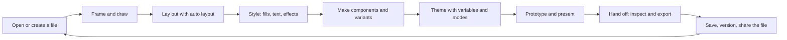

# Core loop and state map

Draft · 13 October 2026 · Phase 1 of the [design plan](PLAN.md)

This map lists every step a designer takes in the six v1 journeys (PRD section 3), the editor states each step needs, and the canvas behaviours behind it. It replaces the old "States still to design" list. The inventory column points to the P0 rows in [`../feature-inventory/`](../feature-inventory/) (`01` = Design, `02` = Design systems and prototyping, `03` = Dev Mode and platform).

Status: **Done** = designed in layout B · **Part** = partly designed · **—** = not designed yet. "Phase" says where the work lands in the [plan](PLAN.md).

## The loop

## Step by step

### A · Open or create a file (journeys 1, 6)

| State | Status | Phase | Inventory |
|---|---|---|---|
| Home / file browser: recent files, folders on disk, new file, import | — | 4 | 01 Interface & navigation; 03 Desktop app |
| Empty file: blank canvas, first-run hints | — | 3, 4 | 01 Interface & navigation |
| Tab switcher (open tabs, other windows, recent files) | Done | — | 01 File utilities |
| Import (Figma REST, .fig, SVG, Penpot) dialog and progress | — | 4 | 01 Import & export |
| Save state and errors (saved, saving, disk full, conflict) | Part (saved only) | 4 | 01 File utilities |

### B · Frame and draw (journey 1)

| State | Status | Phase | Inventory |
|---|---|---|---|
| Tool dock with flyouts (move/scale, frame/section/slice, shapes, pen/pencil, text, comment) | Part (dock done, flyouts —) | 4 | 01 Interface & navigation |
| Frame presets panel (phone, tablet, desktop sizes) | — | 4 | 01 Frames & groups |
| **Canvas:** draw frame and shape, selection, handles, resize, rotate, nudge, duplicate | — | **2** | 01 Position, transform, measure |
| **Canvas:** deep select, multi-select, marquee | — | **2** | 01 Layers; Position |
| **Canvas:** smart guides, snapping, measurement (⌥) | — | **2** | 01 Position, transform, measure |
| **Canvas:** pen tool and vector edit mode, boolean operations | — | **2** | 01 Vector editing |
| Nothing selected (page properties, local variables and styles) | — | 4 | 01 Layers |
| Layers panel: pages, tree, rename, lock, hide, drag to reorder | Part (static) | 4 | 01 Layers |
| Zoom and view menu, rulers, guides, outline mode | — | 2, 4 | 01 View, zoom, rulers |

### C · Lay out with auto layout (journeys 1, 3)

| State | Status | Phase | Inventory |
|---|---|---|---|
| Inspector: auto layout card (direction, wrap, grid, gap, padding, alignment) | Done | — | 01 Auto layout |
| Selected auto-layout frame on canvas: padding and gap handles | — | **2**, 4 | 01 Auto layout |
| Child in auto layout: fill / hug / fixed, absolute position | Part | 2, 4 | 01 Auto layout |
| Constraints and layout guides card | — | 4 | 01 Constraints & layout guides |

### D · Style (journey 1)

| State | Status | Phase | Inventory |
|---|---|---|---|
| Fill card + colour picker (custom, variables, document colours, gradients, image) | Part (picker component only) | 4 | 01 Fills & color picker; Gradients; Images |
| Stroke card expanded (weight, position, per-side, dashes) | — | 4 | 01 Strokes |
| Effects card + menu (shadows, blurs, noise, texture, glass) | Part (menu done) | 4 | 01 Effects |
| Corner radius: independent corners, smoothing | Part | 4 | 01 Corner radius & smoothing |
| Text selected: typography card, text styles, font picker | — | 4 | 01 Text & typography; Fonts |
| **Canvas:** text editing (caret, selection, resize modes) | — | **2** | 01 Text & typography |

### E · Components and variants (journey 3)

| State | Status | Phase | Inventory |
|---|---|---|---|
| Instance selected (properties, reset, swap, detach, go to main) | Done | — | 02 Instances |
| Main component selected (properties editor, description) | — | 4 | 02 Components; Component properties |
| Variant set selected (variant grid, property values) | — | 4 | 02 Variants and component sets |
| Swap instance / assets panel and library browser | — | 4 | 02 Instances; Libraries |
| Create component flow (⌥⌘K) and combine as variants | — | 3 | 02 Components |

### F · Variables and modes (journey 3)

| State | Status | Phase | Inventory |
|---|---|---|---|
| Variables manager (full page: collections, modes, groups, values, aliases, scopes) | — | 4 | 02 Variables: collections, types, scopes |
| Bind a property to a variable (picker from any field) | Part (bound field state only) | 4 | 02 Variables: applying |
| Mode switching on a frame (Dark / Light) | — | 4 | 02 Variable modes |
| Styles (colour, text, effect, grid) create and apply | — | 4 | 02 Styles |

### G · Prototype and present (journey 4)

| State | Status | Phase | Inventory |
|---|---|---|---|
| Prototype mode: connections on canvas, interaction panel (trigger, action, animation) | — | 3, 4 | 02 Prototyping: connections, triggers, animation |
| Flows and starting points, overlays, scroll behaviour | — | 4 | 02 Prototyping: flows and overlays; scroll |
| Presentation view (full screen, device frame, hotspots) | — | 4 | 02 Prototype playback |
| Live preview on a phone over the local network | — | 4 | 03 Mobile app (local equivalent) |

### H · Hand off (journey 5)

| State | Status | Phase | Inventory |
|---|---|---|---|
| Inspect mode: measurements, properties, code (CSS, Tailwind, SwiftUI, Compose) | — | 3, 4 | 03 Dev Mode: inspect panel; code snippets; measurements |
| Export card and export dialog (PNG, SVG, PDF at 1x/2x/3x) | Part (collapsed card) | 4 | 01 Import & export |
| Token export (JSON) | — | 4 | 02 Variables; 03 Dev Mode |
| Comments (pins, threads, resolve) | — | 4 | 02 Comments |

### I · Save, version and share (journeys 1, 6)

| State | Status | Phase | Inventory |
|---|---|---|---|
| Version history panel (named versions, restore, compare) | — | 4 | 02 Branching and merging; 01 File utilities |
| Readable file diff for Git (outside the editor; spec only) | — | 4 | PRD 6.2 file format |
| Preferences (theme, nudge amount, units, shortcuts) | — | 4 | 01 Interface & navigation |

## Cross-cutting states

These apply on every screen and get one spec each in Phase 2 or Phase 4.

| State | Phase |
|---|---|
| Hover, focus ring, pressed, disabled, mixed value, overridden, bound to variable | 2 (spec), 4 (components) |
| Tooltips with shortcuts | 4 |
| Right-click context menu (canvas, layers, pages) | 4 |
| ⌘K command palette and quick actions | 4 |
| Toasts and undo hints | 4 (component done) |
| Light mode | 4 |
| Docked-panel option for layout B (Figma reverted UI3 to docked) | 4, 5 (test) |
| Panels collapsed (canvas only, ⌘\) | 4 |

## Summary

| Area | Done | Part | Not yet |
|---|---|---|---|
| 44 step states above | 3 | 9 | 32 |

The biggest gap is the canvas itself (**Phase 2**): no on-canvas behaviour is specified yet, and it is what makes the tool feel like Figma.
